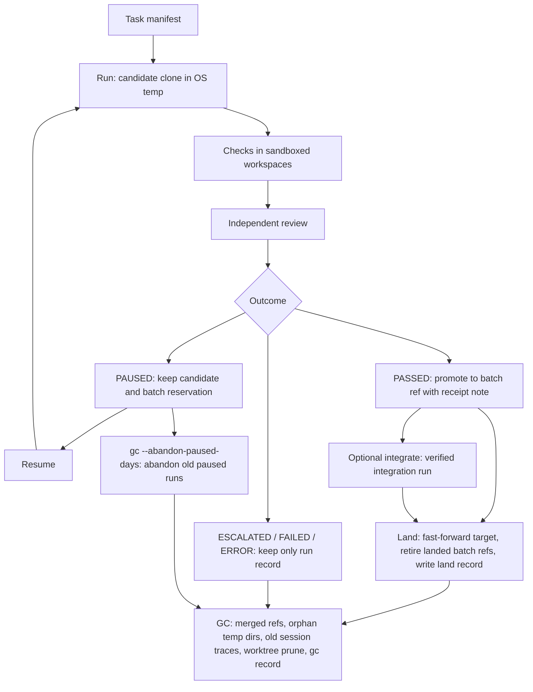

# Operations

## Lifecycle



Every run retains its record and verification evidence, including unsuccessful runs.
Temporary workspaces are normally removed by their controller when the operation
finishes; GC handles leftovers after crashes. Paths below use the repository's
Git common directory, shared by its worktrees.

| Artifact | Where it lives | Who removes it | When |
|---|---|---|---|
| Candidate clone | OS temp, inside a `apocha-*` directory; path recorded as `candidate_root` | Run finalization or GC | On completion except PAUSED; after resume completes, or explicit paused abandonment; orphan cleanup after a crash |
| Check workspace | OS temp, inside a `apocha-*` directory | Check runner or GC | After the check; orphan cleanup after a crash |
| Runtime cwd | OS temp, inside a `apocha-*` directory | Runtime adapter or GC | After the runtime invocation; orphan cleanup after a crash |
| Session dir in run store | `<git-common-dir>/apocha/runs/<run-id>/sessions/NNN/` | GC | Finished runs older than `--keep-days` (default 30), after saving tool analytics totals |
| Run record and evidence | `<git-common-dir>/apocha/runs/<run-id>/` | No automatic removal except session traces | Retained for every outcome |
| Batch ref | Configured `refs.batch_prefix` plus the batch name (default `refs/heads/apocha/batch/<name>`) | Run finalization, land, or GC | Released for unsuccessful runs; kept for PASSED/PAUSED; retired after landing or when merged, subject to ref protections |
| Receipt note | Configured Git notes ref (default `refs/notes/apocha`) | No automatic removal | Retained when batch refs are retired |
| Land record | `<git-common-dir>/apocha/lands/` | No automatic removal | Retained after landing |
| GC record | `<git-common-dir>/apocha/gc/<timestamp>.json` | No automatic removal | Retained after GC apply |
| Temp owner marker | `.apocha-owner` inside the owning temp directory | Controller cleanup or GC, with its directory | On normal cleanup or orphan removal; preserved with paused candidates |

## Keeping a machine clean

Run `apocha status` to see batches, runs needing attention, disk usage, and
suggested commands. Preview cleanup with `apocha gc`, then run
`apocha gc --apply` to carry it out. Paused candidates stay until resumed or
explicitly abandoned with `--abandon-paused-days N`; see Garbage collection below.

To restore a retired ref, use its full OID printed by land or GC, or stored in
the land/GC record:

```bash
git update-ref refs/heads/apocha/batch/example <old-oid> ""
```

The empty expected old value creates the ref only if it is still absent. Receipts
remain Git notes on the commits; deleting or restoring a batch ref does not change them.

## Status

`apocha status [--target <branch>] [--json]` inventories the repository without
locks, writes, or index refreshes. The target defaults to the branch in the main
worktree, or `main` when detached. Clean includes untracked files; an unchecked-out
target has `clean: null`. Receipt configuration comes from the target commit.

JSON always has these top-level keys:

| Key | Shape |
|---|---|
| `target` | `{ branch, ref, tip, worktree, clean }`; worktree and clean may be null |
| `batches` | Array of `{ ref, tip, ahead, behind, receipted, receipts, run, state }` |
| `runs` | `{ total, by_outcome, attention }` |
| `graph` | String from Git log over target and all batch refs, at most 30 commits |
| `last_land` | Null or `{ created_at, commits, retired, kept }` (counts) |
| `last_gc` | Null or `{ created_at, done, skipped, total_size }` (counts and bytes) |
| `disk` | `{ run_store_size, temp: { owned: { count, size }, other: { count, size }, orphan_count } }`; sizes in bytes |
| `suggested_actions` | Array of plain command lines |

Each batch's `receipts` contains `{ commit, valid, reason }` for every commit
ahead of the target; reason is null when valid. `receipted` is true when all
are valid (including an empty set). `run` is null or `{ run_id, outcome }`;
outcome may be null when only the tip's receipt identifies the producer.
States are `landed` (tip is an ancestor of target), `diverged` (target is not
an ancestor on the tip's first-parent chain), `ready` (all ahead commits have
valid receipts and landing can fast-forward), or `unreceipted`.

`by_outcome` includes zero counts for all six recorded outcomes. Attention
entries are `{ run_id, outcome, state, awaiting }` for RUNNING, PAUSED and STALE
runs; stale processes retain their recorded outcome and have state STALE.
Awaiting is the gate, pause reason, or null. Temp ownership uses repository
markers or legacy candidate paths; other includes unowned directories.
Orphans follow GC's dead-owner and old-unowned rules, preserving active runs.
The latest readable land/GC record is selected by creation time.

Human output uses 12-character target and batch OIDs, sizes in B, KiB, MiB,
or GiB, and indented full commands: `apocha land apocha/batch/<name> --target <branch>`
for ready batches, `apocha resume <run-id>` for paused runs, and `apocha gc`
for landed refs or orphan temp directories. JSON retains full OIDs, byte counts,
and its existing suggestion strings (`land <ref> --target <branch>`,
`resume <run-id>`, and `apocha gc`). Suggestions are guidance; commands
revalidate their own preconditions (including landing's clean tracked-worktree requirement).

## Commit messages

Both `run` and `integrate` accept `--message <text>` or `--message-file <path>`,
which reads the commit message from a UTF-8 file relative to the current directory.
Giving both options is a usage error (exit code 2). A message is required for
`run`; `integrate` defaults to `Integrate <topic> into <base>`.

The compatible `--message @file` shorthand also reads a file. To pass text
starting with a literal `@`, double the first `@`: `--message "@@literal"`
produces `@literal`. File contents are used directly, without interpreting
leading `@` characters.

```bash
apocha run task.json --base main --batch example --message-file message.txt
apocha integrate topic --onto main --batch integration --message "@@literal"
```

## Runs

Every `run` and `integrate` creates a run record under `<git-common-dir>/apocha/runs/<run-id>/`,
whatever its outcome. The run ID is `<task-id>-<UTC timestamp>-<4 hex>`, so reruns of a task never
overwrite each other.

```bash
apocha runs                 # newest first: outcome, run id, workflow, reason
apocha show <run-id>        # run.json: inputs, state, outcome
apocha show <run-id> --events   # the event log
```

Outcomes: `RUNNING`, `PASSED`, `FAILED`, `ESCALATED`, `PAUSED`, `ERROR`.

| Outcome | Meaning | What to do |
|---|---|---|
| `PASSED` | Promoted with a receipt | Review the batch commit, then `integrate` or `land` |
| `FAILED` | Deterministic failure: scope violation, or nothing to integrate | Fix the task or the change |
| `ESCALATED` | Needs a person: repair budget exhausted, reviewer escalated, policy violation, integrity failure | Read the reason and the findings in `report.json` |
| `PAUSED` | Usage limit, or waiting at a human gate | `apocha resume <run-id>` (add `--decision` for a gate) |
| `ERROR` | Infrastructure, provider, or config failure after retries | Read `error` in `run.json`; rerun when fixed |

A paused run keeps its candidate directory and its batch ref reservation. Resuming re-enters the
stage that paused, with all earlier evidence.

## Landing and retiring batches

`apocha land <source> --target <branch>` fast-forwards the target after verifying receipts.
It then retires the source when it is under the target configuration's `refs.batch_prefix`
and still points to the landed tip. It also retires integrated topic batch refs identified
from receipt parents and run records when their expected tips are ancestors of the target.
Use `--keep-batch` to keep all batch refs.

Retirement uses `git update-ref -d <ref> <expected-old-oid>`: a moved ref is kept and reported.
The target, refs outside the batch prefix, symbolic refs, refs checked out in any worktree,
and batch refs belonging to RUNNING or PAUSED runs are kept. Each retired ref is printed
with its full old OID. Each land writes JSON under `<git-common-dir>/apocha/lands/`,
including the target, old and new tips, landed commits, retired refs with OIDs, and kept
refs with reasons.

## Garbage collection

The GC preview groups its plan by kind, including counts, byte totals, reasons,
and full OIDs for batch refs. Cleanup requires `--apply`, as described above.

```bash
apocha gc --apply --keep-days 30 --target main
apocha gc --abandon-paused-days 90 --json
apocha gc --apply --abandon-paused-days 90
```

The target defaults to the branch checked out in the main worktree, or `main` if
detached. GC removes batch refs under the configured `refs.batch_prefix` whose tips
are ancestors of the target. Unmerged, symbolic, checked-out, RUNNING, and PAUSED
refs stay. Deletions compare the expected OID, so moved refs stay. See Keeping a
machine clean above for restoring retired refs.

GC also removes OS temp directory `apocha-*` entries with dead owner PIDs, and
unowned entries older than one day. Live owners and paused candidates stay.
Finished runs older than `--keep-days` (default 30) lose only their `sessions/NNN`
trace directories. GC retains `run.json`, `events.jsonl`, `report.json`, and
`verification-*.json`, and saves tool analytics totals before pruning traces.

Only `--abandon-paused-days N` opts into abandoning runs paused for more than N
days (since their last update). They finish as `ERROR` with `infra/abandoned`,
their candidates are removed, and their unchanged batch reservations are released.
Days must be nonnegative numbers. GC runs `git worktree prune` on apply and writes
the actions and skipped items to `<git-common-dir>/apocha/gc/<timestamp>.json`.

## Events

`events.jsonl` has one JSON object per line with `at` and `type`. Types include `run.started`,
`stage.started`, `stage.completed`, `agent.started`, `agent.finished`, `agent.retry`,
`check.finished`, `verification.finished`, `review.finished`, `budget.spent`,
`promotion.finished`, `receipt.written`, `run.paused`, `run.resumed`, `stage.failed`, and
`run.finished`. The log is the input for dashboards and a future UI: a UI reads it and calls the
CLI; it never changes run state itself.

## Metrics

```bash
apocha metrics              # all runs in this repository's run store, all receipts
apocha metrics --ref main   # receipts only on commits reachable from main
apocha metrics --json       # includes the definitions below
```

Two views, kept apart on purpose:

- **Runs** count every run, including failures. `first_attempt_pass_rate` is task runs that
  passed with zero repairs over all finished task runs. `harness_error_rate` is runs that ended
  in `ERROR` over all finished runs.
- **Deliveries** come from receipts, so they only cover work that passed. An integration is a
  receipt on a merge commit (two parents); it is counted separately because merges rarely need
  repair and would inflate repair-free rates.

Reporting only the delivery view overstates success, since a task that never passes leaves no
receipt. Publish both, with their definitions and date range.

## Analytics

`apocha analytics` reports the current repository's recorded run window, outcomes,
task delivery and first-run rates, repair distribution, check failures and durations,
review decisions and findings per fix, runtime pass rates and token usage, tool errors
and run_check pass rates by role, and median and p90 run durations.

```bash
apocha analytics
apocha analytics --since 2026-01-01 --until 2026-01-31 --workflow code-delivery
apocha analytics --json
apocha analytics --format md
```

`--since YYYY-MM-DD` and `--until YYYY-MM-DD` filter by inclusive UTC run creation
dates; `--workflow <id>` selects an exact workflow ID. `--format text|md` selects
text (the default) or Markdown. `--json` prints the analytics object with definitions.
Every rate's definition is printed by `--json` and `--format md`. Missing values
appear as `n/a` in text and Markdown.

## Troubleshooting

| Symptom | Likely cause | Fix |
|---|---|---|
| `ERROR` with `infra/dependencies_missing` | `node_modules` not installed in the source checkout | `npm ci` in the check's `cwd` |
| `ERROR` with `infra/dependency_contract` | Source checkout's `package.json` or lock differs from the base | Sync the checkout with the base commit |
| Check `fail` with `integrity/dependency_contract` | The candidate changed `package.json` or the lock | Dependency changes need a person; do them outside the agent run |
| Check `infra_error` with `timeout` | Slow machine or hung test | Raise `timeout_ms`, or stop other heavy processes |
| A check fails only under the sandbox | It needs network, a denied path, or a write outside its tree | Set `network: true` for that check, or point caches at `HOME`/`TMPDIR` |
| `PAUSED` with "usage limit reached" | The runtime's plan limit | `apocha resume <run-id>` after the reset time |
| `ESCALATED` with `policy_violation` | The runtime used a capability outside the harness | Run `apocha doctor --live`; update the adapter's disable list |
| `land` refuses with "no valid receipt" | A commit between target and source was not promoted by a run | Integrate it through `apocha integrate`, or land up to the last receipted commit |
| `repository is locked by pid ...` | Another Apocha process holds the lock | Wait; a dead owner's lock is recovered automatically |
